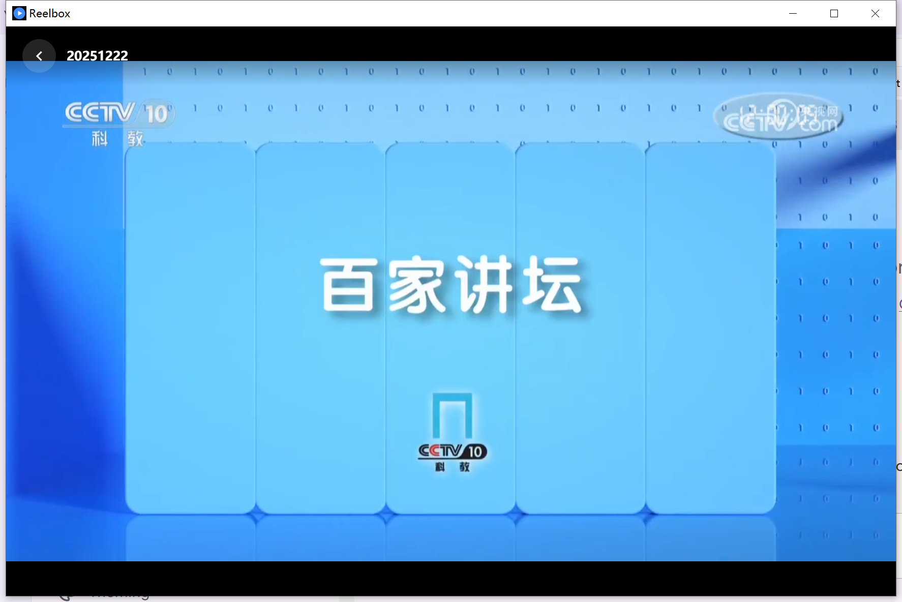

# 播放功能

状态:**已实现并实测通过**(2026-11-14,提交 `f7eb7c0`)。



## 为什么要本地反代

桌面 WebView 直接播 m3u8 有三个绕不过去的问题:

1. **Chromium 不支持 HLS 原生解码** —— 只有 Safari 支持,其余都要走 MSE
2. **防盗链** —— 片源校验 UA / Referer,前端直接 fetch 会被 403
3. **跨域** —— 页面在 `tauri.localhost`,片源在别的域

所以由 Rust 侧起一个只监听 `127.0.0.1` 的服务,把清单和分片都代理一遍:

```
hls.js ──> http://127.0.0.1:<随机端口>/p?u=<base64url 地址>&h=<base64url 请求头>
                │
                ├─ 带 UA/Referer 去上游取
                ├─ 内容像 m3u8 → 逐行改写地址,再套一层同样的本地地址
                │                 (含 #EXT-X-KEY / #EXT-X-MAP 的 URI="...")
                └─ 是分片 → 原样回传,补 Access-Control-Allow-Origin
```

端口由 `tiny_http` 绑定 `127.0.0.1:0` 时分配,进程内复用。

## 分享页抽流

电影天堂给的地址不是流,而是一张分享页:

```html
<script>
  const url = "/20251222/65250_ab09f628/index.m3u8?sign=5a1ed332db9baba5b099c6075c704831";
</script>
```

`Client::stream()` 发现地址既不含 `.m3u8` 也不含 `.mp4` 时,会:

1. 请求该页面
2. 从 HTML/JS 里捞出第一个 `.m3u8` 地址(支持相对路径、`\/` 转义、`?sign=` 查询串)
3. 把页面地址作为 Referer 一并带回

对应实现:`core/src/source/cms.rs` 的 `resolve_media` / `extract_m3u8` / `absolute`。

## 代码位置

| 文件 | 职责 |
| --- | --- |
| `src-tauri/src/proxy.rs` | 本地反代服务、m3u8 改写、CORS |
| `src-tauri/src/commands.rs` | `player_url` 命令:把流地址包成本地地址 |
| `core/src/source/cms.rs` | `resolve_media`:分享页 → m3u8 |
| `ui/index.html` | `.player` 整屏覆盖层 + `<script src="vendor/hls.min.js">` |
| `ui/app.js` | `playEpisode` / `openPlayer` / `closePlayer` |

## 怎么验证

### 1. 单元测试

```bash
cargo test -p reelbox-core
```

期望:`34 passed; 0 failed`。其中三条覆盖分享页抽流:

- `finds_relative_m3u8` —— 相对路径 `/20251222/.../index.m3u8?sign=abc`
- `finds_absolute_m3u8` —— 绝对地址
- `none_when_absent` —— 页面里没有 m3u8 时返回 None

### 2. 手工验证

```bash
cargo build -p reelbox --target x86_64-pc-windows-gnu
"target-dir/x86_64-pc-windows-gnu/debug/reelbox.exe"
```

1. 选一个源 → 点任意封面进详情 → 点任意一集
2. 期望:黑底播放页出现,片名在左上角,画面几秒内起播
3. 拖动进度条可以跳转;按 `Esc` 或点左上角箭头退出

实测截图见 `docs/playback.png`(《百家讲坛》20251222,画面为 CCTV-10 片头)。

## 识别真实流类型(2026-11-14 修)

插件按**地址后缀**猜 mime,可签名地址往往没有后缀。4k影视 有些片名给的是
ByteDance CDN 上的直链 mp4(`...~tplv-xxxx-image.image?x-sign=...`,598 MB),
插件却写成 `application/vnd.apple.mpegurl` —— hls.js 把 mp4 当清单解析,直接
`manifestParsingError`,页面停在 `readyState=0`。这就是"同一份二进制两次结果不同"的原因:
列表第一条是哪个片名由源站更新决定,不是随机抖动。

所以宿主不再相信插件声明的 mime,播放前用 `stream_kind` 探一次真实字节:

```
play 钩子 ──> {url, mime:"application/vnd.apple.mpegurl"}   ← 插件说的
stream_kind ──> 取头 4KB(Range: bytes=0-4095)
                ├─ #EXTM3U            → kind=hls   → hls.js
                ├─ ftyp/moov/mdat…    → kind=file  → 原生 <video src=反代地址>
                └─ 认不出来           → kind=unknown → 仍走 hls.js(错误照旧上报)
```

反代同步收紧:

- **只改写真正的清单**:body 以 `#EXTM3U` 开头才逐行改写;不是清单就原样回传,
  不再"因为 URL 里有 .m3u8 就硬改"
- **媒体本体流式透传**:`video/*`、`audio/*`、`.mp4/.ts/.m4s/...` 不走内存缓冲,
  直接 `tiny_http::Response::new(reader)` 流给播放器
- **Range 透传**:请求带 `Range` 就转给源站,把 `206` + `Content-Range` 照抄回来,
  拖动进度条不再从零重下(以前 598 MB 的片子还会被 96 MB 缓冲上限截断)

## 已知限制

- 直链 mp4 走原生 `<video>`,没有清晰度切换(多档只在 HLS 下有意义)
- 没有手动选清晰度
- 反代只监听本机,不对外暴露

## 验收清单

| 项 | 状态 | 判定方式 |
| --- | --- | --- |
| 点剧集能进播放页 | 通过 | 截图 `docs/playback.png` |
| 画面真的在播(不是静止图) | 通过 | 相隔 6 秒两帧的 md5 不同 |
| 分享页能抽出 m3u8 | 通过 | `cargo test extract_tests` 3 条 |
| 防盗链 UA/Referer 生效 | 通过 | 反代日志里分片返回 200 |
| 退出播放不泄漏 | 通过 | `closePlayer` 销毁 Hls 实例并清 `src` |
| 进度记忆 | 通过 | 播放后退出,详情页出现"继续观看 · 集名 · 时间" |
| 播完自动下一集 | 通过 | video `ended` 时按扁平剧集表顺延 |

一键复核:

```powershell
powershell -ExecutionPolicy Bypass -File verify-playback.ps1
```

## 播放器交互

| 操作 | 行为 |
| --- | --- |
| 空格 | 播放 / 暂停 |
| ← / → | 后退 / 前进 10 秒 |
| F | 全屏切换 |
| Esc | 退出播放 |
| 鼠标静止 2.6 秒 | 顶部标题条淡出 |

## 进度记忆

- 存储:localStorage 的 `reelbox.progress`,键是 `<源ID>|<片名>`
- 值:`{ id, name, t, at }`,`t` 是秒
- 每 5 秒写一次(且只在 ≥3 秒时写),关闭播放器时强制写一次
- 再打开同一集自动跳到上次位置;详情页顶部出现「继续观看 · 集名 · 时间」

## 多源验证(2026-11-14)

| 源 | 分享页 | 抽出的地址 | 结果 |
| --- | --- | --- | --- |
| 电影天堂 dytt | `vip.dytt-cine.com/share/...` | `/2025..*/index.m3u8?sign=...` | 界面实测起播 |
| 量子资源 lzzy | `v.lzcdn27.com/share/...` | `/20260427/9445_0f2985ca/index.m3u8?sign=...` | 清单/子清单/分片全部 200 |

量子源的实测链路(命令行,不经过界面):

```
master   #EXTM3U + EXT-X-STREAM-INF  → 2000k/hls/mixed.m3u8
variant  #EXTINF:4.2, c1cec772ce0000000.ts
segment  HTTP 200, 996,400 bytes
```

两个源都是「分享页 → 相对路径 m3u8」的同一形态,走的是同一段 `resolve_media` + `extract_m3u8`。

## 排查手段

### 日志

前端所有关键节点都会写一行日志,两份副本:

- **内存环形缓冲**(最近 300 行):按 `Ctrl+Shift+D` 在窗口底部弹出面板,实时刷新
- **落盘**:`%APPDATA%\reelbox\reelbox.log`,追加写

已埋的点:

| 事件 | 内容 |
| --- | --- |
| `init start` | 前端启动 |
| `switchSource` | 切源 |
| `openDetail` | 打开详情 |
| `playEpisode` | 点某集 |
| `play hook` | 插件 `play` 钩子耗时 + 它给的原始地址(截断)+ mime |
| `probe` | `stream_kind` 的结论:kind / HTTP 码 / content-type / 采样字节数 |
| `play mode` | 最终走 hls.js 还是原生 `<video>`(以及为什么) |
| `stream` | 取流成功(mime + 反代地址前 90 字符 + 清晰度档数) |
| `HLS ERR` | hls.js 每次报错:`type` / `details` / `fatal` / `response.code` / `url` |
| `HLS FATAL` | 致命错误(播放中断) |
| `VIDEO ERR` | `<video>` 的 `error.code` / `error.message` / networkState |
| `M3U8 probe` | 自检失败时再拉一次反代地址:HTTP 码 / 字节数 / 是不是 `#EXTM3U` |
| `STREAM FAIL` | 取流失败原因 |

Rust 侧(同一个文件、同样带 `HH:MM:SS`)还会写:

| 事件 | 内容 |
| --- | --- |
| `PROXY m3u8` | 清单请求:状态码 / 字节数 / content-type / content-encoding / 请求头 |
| `PROXY media` | 媒体(分片或 mp4 直链):状态码 / content-type / content-length / Range |
| `PROXY NOT-M3U8` | 以为拿到清单、结果不是:带上前 400 字节(解析失败的现场) |
| `PROXY http` / `PROXY ERR` | 源站 4xx/5xx(状态码与响应体前 160 字节)/ 连接失败 |
| `PROBE` | `stream_kind` 探测结论 |
| `SELFTEST` | 自检各阶段(前端写的,同一文件) |

出问题时,把 `Ctrl+Shift+D` 面板截个图,或者直接把 `reelbox.log` 发我,比口头描述快得多。
